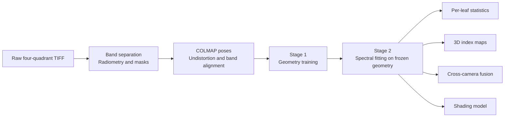

<h1 align="center">plant3d</h1>

<p align="center">
  Multispectral plant reconstruction and per-leaf vegetation indices with 3D Gaussian Splatting
</p>

<p align="center">
  <a href="pyproject.toml"></a>
  <a href="pyproject.toml"></a>
  <a href="third_party/gsplat"></a>
  <a href="LICENSE"></a>
</p>

<p align="center">
  <strong>English</strong> · <a href="doc/README.zh-CN.md">简体中文</a> · <a href="doc/README.ja.md">日本語</a>
</p>

<p align="center">
  <a href="#overview">Overview</a> ·
  <a href="#getting-started">Getting Started</a> ·
  <a href="#method">Method</a> ·
  <a href="#results">Results</a> ·
  <a href="#citation">Citation</a>
</p>

<p align="center">
  
  <br>
  <sub>The reconstructed houseplant at six azimuths. Top: color-infrared composite. Middle: red-edge chlorophyll index (CIre). Bottom: near-infrared reflectance.</sub>
</p>

<a id="overview"></a>

## Overview

**plant3d** is a research implementation for reconstructing plants from multiview images and associating multispectral measurements with individual leaves in 3D. It uses [gsplat](https://github.com/nerfstudio-project/gsplat) to learn a 3D Gaussian representation, then estimates reflectance in each spectral band while keeping the geometry fixed.

The project originated as a university research project and has been reorganized for public release. Its intended acquisition setup pairs an RGB camera with a USB industrial camera whose infrared-cut filter is removed and replaced with an 850 nm narrowband filter. All real-data experiments reported here use the public [Multispectral Greenhouse dataset](https://doi.org/10.5281/zenodo.18838172), which provides an 820 nm NIR band.

- **Multispectral reconstruction:** geometry training followed by spectral fitting on frozen Gaussians.
- **Per-leaf analysis:** SAM segmentation, association across views, and measured vegetation indices with uncertainty estimates.
- **Cross-camera fusion:** transfer of NIR observations to RGB-camera viewpoints, evaluated against 2D registration.
- **Visualization and evaluation:** 3D index maps, `.ply` and `.splat` export, held-out views, and simple baselines.

> **Scope.** The main demonstrated benefit is associating measurements of the same leaf across viewpoints. The reported 3D models do not consistently improve whole-plant NDVI over simple baselines. Reflectance is relative to an estimated white reference; absolute index values require careful radiometric calibration.

<a id="getting-started"></a>

## Getting Started

Run the following commands from the repository root. Datasets, trained checkpoints, and experiment notebooks are not included; the download scripts retrieve the input data separately.

### Requirements

| Component | Repository configuration |
| :--- | :--- |
| Python | 3.12 |
| Environment manager | [uv](https://docs.astral.sh/uv/) |
| PyTorch | 2.14.1 from the official CUDA 13.0 wheel index |
| GPU | CUDA-capable NVIDIA GPU |
| Build toolchain | CUDA toolkit compatible with the configured PyTorch build, including `nvcc`, and a C++20-capable compiler |
| gsplat | Vendored version 1.5.3 with the included C++20 build patch |
| Download scripts | Bash, `curl`, and `python3` |

The build settings in [pyproject.toml](pyproject.toml) target `TORCH_CUDA_ARCH_LIST = "12.0"` and `CUDA_HOME = "/opt/cuda"`. Adjust them **before installation** if your GPU or CUDA installation differs. The local CUDA toolkit must match the major version of the configured PyTorch CUDA build.

### 1. Install

```bash
uv sync
uv run pytest
```

The first installation compiles the gsplat CUDA extension. The default `uv sync` also installs the development dependencies used for testing, plotting, and SAM segmentation. Tests requiring CUDA or the ficus dataset are skipped when those prerequisites are unavailable.

<details>
<summary>gsplat build configuration</summary>

The source in [third_party/gsplat](third_party/gsplat) already includes the change documented in [gsplat-1.5.3-cxx20.patch](third_party/gsplat-1.5.3-cxx20.patch). It changes the CUDA compiler standard from C++17 to C++20 for compatibility with the configured PyTorch headers.

After changing the GPU architecture or CUDA path in `[tool.uv.extra-build-variables]`, rebuild the extension:

```bash
uv sync --reinstall-package gsplat
```

</details>

### 2. Validate geometry training on ficus

Download the NeRF-synthetic ficus scene (approximately 134 MB) and train for 30,000 steps:

```bash
./scripts/download_ficus.sh
uv run python -m plant3d.train_rgb \
  --data data/nerf_synthetic/ficus \
  --max-steps 30000 \
  --test-every 1 \
  --out outputs/ficus_rgb_30k
```

### 3. Reconstruct a multispectral plant

The greenhouse download script retrieves only the selected plant using HTTP range requests (approximately 310 MB for `houseplant`). Keep the following commands in the same shell session:

```bash
P=houseplant
D="data/greenhouse/${P}_prep/undistorted"

# Download and preprocess the raw spectral images.
./scripts/download_greenhouse.sh "$P"
uv run python -m plant3d.prep_greenhouse \
  --src "data/greenhouse/$P" \
  --out "data/greenhouse/${P}_prep"

# Stage 1: train geometry.
uv run python -m plant3d.train_rgb \
  --format colmap --data "$D" \
  --max-steps 30000 --test-every 4 --test-group 4 \
  --out "outputs/${P}_rgb"

# Stage 2: fit spectral channels with geometry frozen.
uv run python -m plant3d.train_channels \
  --geometry "outputs/${P}_rgb/ckpt_30000.pt" --data "$D" \
  --test-every 4 --test-group 4 --batch-views 4 \
  --out "outputs/${P}_spectral"

# Associate leaves across views and aggregate measurements.
uv run python -m plant3d.leaves \
  --spectral "outputs/${P}_spectral/spectral.pt" --data "$D" \
  --test-every 4 --test-group 4 \
  --out "outputs/${P}_leaves"
```

`--test-every 4 --test-group 4` holds out every fourth group of four frames, corresponding to a complete azimuth stop for `houseplant`. Use the same split for geometry training, spectral fitting, and leaf analysis. For other scenes, match `--test-group` and the leaf module's `--frames-per-stop` to the number of frames per stop (`cotton` uses five). The first leaf-segmentation run downloads `facebook/sam-vit-base` through Transformers.

### 4. Inspect the outputs

| Output | Contents |
| :--- | :--- |
| `outputs/${P}_rgb/ckpt_30000.pt` | Geometry checkpoint for spectral fitting |
| `outputs/${P}_rgb/point_cloud.ply` | Reconstructed Gaussian scene |
| `outputs/${P}_spectral/spectral.pt` | Geometry and learned spectral channels |
| `outputs/${P}_spectral/point_cloud_ndvi.ply` | Gaussian scene colored by NDVI |
| `outputs/${P}_spectral/results.json` | Evaluation metrics, baselines, and confidence intervals |
| `outputs/${P}_leaves/gaussian_leaves.pt` | Leaf assignments and weights for the Gaussians |
| `outputs/${P}_leaves/per_leaf_summary.csv` | Multiview measured NDVI means, standard deviations, and standard errors |

Open the exported `.ply` files in [SuperSplat](https://superspl.at/editor). Commands use `tyro`; append `--help` to inspect their options:

```bash
uv run python -m plant3d.train_channels --help
```

<a id="method"></a>

## Method



1. **Preprocessing.** Extract green, red, red-edge, and NIR bands from raw TIFF images. Subtract estimated dark levels and normalize by a white reference. Re-estimate camera poses with COLMAP, remove lens distortion, and align the spectral bands.
2. **Geometry training.** Train standard 3DGS with an L1 + SSIM loss. Composite each training image over a random solid background to suppress background Gaussians.
3. **Spectral fitting.** Freeze Gaussian positions, shapes, and opacities; learn reflectance for each band. Optional components include view-dependent spherical harmonics, per-frame gains, a shading model, and rendering multiple views per optimization step.
4. **Leaf association and analysis.** Segment leaves in training views with SAM, project the masks onto Gaussians, and merge them across views. Use the resulting 3D labels for leaf statistics, index maps, and fusion experiments.

## Data

The [Multispectral Greenhouse dataset](https://doi.org/10.5281/zenodo.18838172) accompanies [LGDWT-GS](https://arxiv.org/abs/2601.17185) and is distributed under CC BY 4.0. It contains five potted plants captured on a turntable against a black background under fixed LED illumination. The four-lens snapshot camera records 580, 660, 735, and 820 nm bands, with approximately 64 frames per plant. This project reports experiments on `houseplant`, `cotton`, and `tomato`.

<p align="center">
  
  <br>
  <sub>Left: raw TIFF with one spectral band per quadrant. Right: the corresponding supplied PNG, with each band independently stretched. Quantitative analysis uses the raw TIFF data.</sub>
</p>

The preprocessing pipeline addresses the following observations from the dataset:

| Observation | Treatment |
| :--- | :--- |
| Supplied reconstructions registered only 16 of 64 frames per model and used the default COLMAP focal length | Re-run COLMAP; all 64 houseplant frames register. The estimated focal length is approximately 345 px and radial distortion approximately −0.12. |
| Supplied PNGs are independently stretched to 8 bit | Read the original 10-bit measurements stored in TIFF files. |
| Bright leaf veins contaminate the white-reference estimate | Exclude low red/NIR-ratio candidates from the brightest 2% of pixels; use the pot and turntable as the white reference. |
| Fixed inter-lens shifts of 0.4–0.76 px | Estimate shifts by phase correlation, take the median per camera, and combine alignment with undistortion in one resampling operation. |
| Four heights are captured at each houseplant azimuth stop | Hold out complete azimuth groups to avoid keeping adjacent heights from the same stop in training. |
| No gray reference panel is present | Treat reflectance as relative to the white pot and absolute NDVI values as provisional. |

<a id="results"></a>

## Results

The figures and measurements below are retained from the project's reported experiments. The quick-start commands cover the main pipeline; reproducing the full tables also requires the corresponding seeds and experimental configurations.

### Key findings

- **Local spectral transfer:** on held-out azimuths, 32 px block NDVI error is **0.036**, compared with **0.041** for a constant baseline.
- **Whole-plant limits:** the default model's error is **0.023**, compared with **0.018** for the constant baseline. The first-order view term with per-frame gains reaches **0.0174**.
- **Leaf association:** within-leaf NDVI variation across views is approximately **0.04**, compared with approximately **0.03** between leaves. Multiview averaging reduces the standard error to approximately **0.007**.
- **Cross-camera fusion:** 3D fusion outperforms planar 2D registration beyond approximately **2°** of viewpoint separation in the reported experiment.
- **Radiometric sensitivity:** dark-level and white-reference choices shift NDVI by approximately **0.06** and **0.1**, respectively, exceeding the reconstruction improvements reported here.

### Held-out NDVI accuracy

The houseplant evaluation uses 16 views held out by complete azimuth groups and three geometry seeds. Errors are mean absolute differences between rendered and measured NDVI. Brackets denote 95% bootstrap confidence intervals; ± values report variation across seeds. A dash indicates an unreported value.

| Scale | 3D model | Constant baseline | Nearest training view | Read-noise floor |
| :--- | ---: | ---: | ---: | ---: |
| Pixel | 0.126 [0.116, 0.136] | — | — | 0.011 |
| 8 px block | 0.067 [0.060, 0.075] | 0.066 | — | — |
| 32 px block | 0.036 ± 0.001 | 0.041 | — | — |
| Whole plant | 0.023 ± 0.000 | 0.018 | 0.023 | — |

<p align="center">
  
  <br>
  <sub>One held-out view per plant. Left: color-infrared composite. Middle: measured NDVI. Right: NDVI rendered from the 3D model.</sub>
</p>

The same pipeline with unchanged parameters and seed 0 gives:

| Metric | houseplant | cotton | tomato |
| :--- | ---: | ---: | ---: |
| Registered frames | 64 | 50 | 42 |
| Held-out views | 16 | 15 | 9 |
| Geometry PSNR / silhouette IoU | 20.35 / 0.71 | 15.98 / 0.45 | 22.05 / 0.83 |
| Pixel error / noise floor | 0.126 / 0.011 | 0.125 / 0.018 | 0.109 / 0.010 |
| 32 px block: model / constant | 0.036 / 0.041 | 0.054 / 0.066 | 0.038 / 0.030 |
| Whole plant: model / constant / nearest view | 0.023 / 0.018 / 0.023 | 0.039 / 0.018 / 0.010 | 0.017 / 0.016 / 0.009 |

At the whole-plant scale, the model does not outperform the simple baselines for any of the three plants. Houseplant has a systematic NDVI bias of approximately −0.018, associated with roughly 6% underestimation of NIR inside leaves. The cause remains unresolved.

### Per-leaf statistics

<p align="center">
  
  <br>
  <sub>SAM masks projected onto Gaussians and merged across views produce 19 leaves in 3D; 11 are visible in enough views for statistical analysis.</sub>
</p>

For an individual held-out view, per-leaf NDVI error is **0.042**, compared with **0.037** when using that leaf's mean measured NDVI in training views. The supported per-leaf output is therefore the multiview mean of measured values and its standard error, written to `per_leaf_summary.csv`. This summary pools all evaluated views in which each leaf is visible; held-out prediction comparisons are a separate evaluation.

### Cross-camera fusion

The experiment uses only green and red from `cam1` to simulate an RGB camera, and only 820 nm NIR from `cam2` to simulate a separate NIR camera. The NIR band from `cam1` is reserved for ground truth. Per-camera color matrices allow both cameras to share a geometry model.

This experiment trains on all 64 frames and evaluates spectral transfer on the 32 `cam1` views over three seeds. It measures cross-camera transfer, separately from the held-out-view experiment above.

| Method | Pixel | 32 px block | Whole plant |
| :--- | ---: | ---: | ---: |
| 2D: planar homography | 0.199 | 0.108 | 0.033 |
| 2D: best plane depth per frame, oracle reference | 0.175 | 0.098 | 0.041 |
| 3D: rendered NIR, measured red | 0.123 | 0.068 | 0.032 |
| 3D: rendered NIR and red | 0.122 | 0.062 | 0.024 |

<p align="center">
  
  <br>
  <sub>NDVI error as viewpoint separation increases. Left: pixels. Middle: 32 px blocks. Right: whole plant.</sub>
</p>

<p align="center">
  
  <br>
  <sub>Ground truth and fusion results at viewpoint separations of 0.2°, 8.3°, and 19.6°.</sub>
</p>

The 2D method's pixel error rises from 0.09 to 0.26 as viewpoint separation increases, while the 3D error remains approximately stable. The curves cross near 2° in this experiment.

### Shading model

The optional model is enabled with `--shading` in `plant3d.train_channels`:

```text
observation = reflectance × (ambient + max(0, n·l) + transmission × max(0, −n·l))
```

Normals are taken from the shortest axes of flattened Gaussians. Light direction is constant in each camera's turntable coordinate frame; ambient and transmission terms are learned per band.

<p align="center">
  
  <br>
  <sub>Simulated NIR albedo recovery. Left: light next to the camera. Right: light separated from the camera by 70°.</sub>
</p>

- **Simulation:** correlation with true reflectance improves from 0.88–0.92 to 0.999. With smoothed normals, recovered ambient intensity is 0.41 for a true value of 0.40, and recovered transmission is 0.30–0.31 for a true value of 0.30.
- **Real data:** held-out error is unchanged across five seeds. Learned NIR ambient intensity is 2.7 times the direct term, while transmission approaches zero. Smoothing normals does not improve the result.
- **Remaining orientation effects:** correlation between leaf NIR and mean illumination cosine decreases only from 0.74 to 0.69. Canopy occlusion, multiple reflections, specular surfaces, and extended light sources may contribute to this mismatch.

For new acquisitions intended to test this model, separate lighting from the camera, use two or three known light directions, reduce stray light, and include gray panels at several orientations.

### Geometry validation on ficus

Evaluation uses all 200 test views.

| Training background | Steps | PSNR | SSIM | Background fog | Gaussians | Training time |
| :--- | ---: | ---: | ---: | ---: | ---: | ---: |
| White | 30,000 | 28.44 | 0.971 | ≈90% | 308,000 | 10.5 min |
| Random | 7,000 | 31.47 | 0.980 | 0.08% | 132,000 | 2.2 min |
| Random | 30,000 | 33.63 | 0.986 | 0.04% | 178,000 | 8.7 min |

<p align="center">
  
  <br>
  <sub>Top: training on white produces background Gaussians visible when rendered on black. Bottom: random-background training suppresses this artifact.</sub>
</p>

A fixed background allows similarly colored Gaussians to accumulate without a corresponding training-loss penalty. These Gaussians can obscure the plant from novel viewpoints. Random-background compositing is enabled by default.

## Repository Layout

Python modules are under [`src/plant3d/`](src/plant3d).

| Module or directory | Purpose |
| :--- | :--- |
| `data.py` | NeRF-synthetic and COLMAP loading, OpenCV camera conventions, and grouped view splits |
| `gaussians.py`, `losses.py` | Gaussian initialization, rendering, optimization, checkpoints, export, and image losses |
| `train_rgb.py` | Geometry training and per-camera color matrices |
| `prep_greenhouse.py` | Band extraction, radiometry, masks, COLMAP, undistortion, and band alignment |
| `train_channels.py`, `spectral.py` | Spectral fitting, NDVI/NDRE, evaluation, baselines, and confidence intervals |
| `leaves.py` | SAM segmentation, 3D leaf association, and per-leaf statistics |
| `plant_maps.py`, `export_splat.py` | 3D chlorophyll and structural index maps, `.ply`/`.splat` export, and color layers |
| `fusion.py` | Cross-camera fusion and planar-homography comparisons |
| `shading.py`, `shading_sim.py` | Shading model and simulation validation |
| [`scripts/`](scripts) | Dataset downloads and selective remote ZIP extraction with retries and resumption |
| [`tests/`](tests) | Unit tests for data conventions, rendering, export, and registration |
| [`doc/`](doc) | Chinese and Japanese README translations |
| [`docs/images/`](docs/images) | Figures used in all language versions |
| [`third_party/`](third_party) | Vendored gsplat source and build patch |

## Acknowledgments

- **Multispectral data:** [Multispectral Greenhouse](https://doi.org/10.5281/zenodo.18838172), released with [LGDWT-GS](https://arxiv.org/abs/2601.17185), CC BY 4.0.
- **Geometry validation data:** the ficus scene from [NeRF-synthetic](https://www.matthewtancik.com/nerf).
- **Gaussian rasterization:** [gsplat](https://github.com/nerfstudio-project/gsplat), Apache 2.0.
- **Leaf segmentation:** [Segment Anything](https://github.com/facebookresearch/segment-anything), using `facebook/sam-vit-base`.

<a id="citation"></a>

## Citation

If you use this code or its reported results in a publication, report, or other work, please credit the author. Machine-readable metadata is available in [CITATION.cff](CITATION.cff).

```bibtex
@software{hiro_plant3d_2026,
  author  = {Hiro},
  title   = {plant3d: Multispectral 3D Gaussian Splatting of Plants for Per-Leaf Vegetation Indices},
  year    = {2026},
  version = {0.1.0}
}
```

## License

Project code is distributed under the [PolyForm Noncommercial License 1.0.0](LICENSE). Noncommercial use and modification are permitted under its terms. Commercial use requires a separate license from the author. Redistribution must include the license terms or their URL and preserve the `Required Notice:` statement supplied in `LICENSE`.

Vendored dependencies retain their original licenses: gsplat uses [Apache 2.0](third_party/gsplat/LICENSE), and GLM uses the [MIT license](third_party/gsplat/gsplat/cuda/csrc/third_party/glm/copying.txt). The Multispectral Greenhouse dataset is licensed under CC BY 4.0 and is not included in this repository. Figures in `docs/images/` include results derived from that dataset and the NeRF-synthetic ficus scene.
