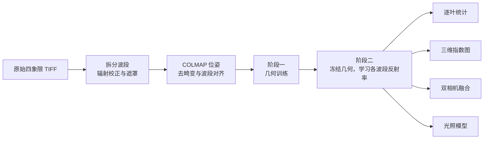

<h1 align="center">plant3d</h1>

<p align="center">基于三维高斯泼溅的植株多光谱重建与逐叶植被指数测量</p>

<p align="center">
  
  
  
  
  
</p>

<p align="center">
  
  <br><sub>houseplant 的三维模型在六个方位角下的渲染。上：彩红外合成；中：叶绿素指数 CIre；下：近红外反射率，反映叶片结构。</sub>
</p>

本项目源自作者大学期间的一项课题，现经重新整理与润色后开源。

植物的光合能力通常以 NDVI 等植被指数间接表征，而单张照片中的指数受叶片朝向、遮挡和视角影响。本项目先用 [gsplat](https://github.com/nerfstudio-project/gsplat) 由多视角图像重建植株的三维高斯模型，再在冻结的几何上为每个高斯学习各波段反射率，从而把不同视角、不同相机的像素关联到同一片叶子上，在三维空间中统计 NDVI、叶绿素指数和近红外反射率。

目标硬件为一台去除红外截止滤片并加装 850 nm 窄带滤光片的 USB 工业相机，配合一台 RGB 相机。现阶段的全部实验均在公开的 [Multispectral Greenhouse](https://doi.org/10.5281/zenodo.18838172) 数据集上完成。

## 主要结论

- **局部尺度上，三维模型能够把光谱信息传递到未参与训练的视角。** 在整方位留出的视角上，32 px 块的 NDVI 误差为 0.036，低于常数基线的 0.041。
- **整株尺度上，三维模型并不优于简单基线。** 整株 NDVI 误差为 0.023，常数基线为 0.018；仅"一阶视角项加逐帧增益"的配置达到 0.0174。
- **三维重建的主要价值在于跨视角的像素关联。** 同一叶片在不同视角下的 NDVI 标准差约 0.04，叶片之间约 0.03；经多视角平均后标准误降至约 0.007，叶片之间因此可以区分。
- **双相机融合中，视差超过约 2° 时三维融合优于二维配准。** 单像素 NDVI 误差为 0.12，二维平面单应为 0.20，且三维方法的误差不随视差增大。
- **简单光照模型无法消除真实数据中的叶片朝向效应。** 该模型在模拟数据上可恢复叶片反射率，与真值的相关系数由 0.88 至 0.92 提高至 0.999；在真实数据上则无改善。
- **NDVI 的绝对值取决于辐射定标。** 暗电平和白参考的不同取法分别带来约 0.06 和 0.1 的差异，大于上述任何重建误差。跨数据比较绝对值之前，须在拍摄时放置灰板。

## 方法



1. **预处理**：从原始 TIFF 拆出绿、红、红边、近红外四个波段，扣除暗电平并除以白参考得到相对反射率；重新运行 COLMAP 求解位姿，去畸变，并校正各镜头之间的亚像素视差。
2. **阶段一，几何**：以 L1 加 SSIM 损失训练标准 3DGS。训练时每步合成随机纯色背景，以抑制背景雾。
3. **阶段二，光谱**：固定高斯的位置、形状和不透明度，仅为每个高斯学习各波段的反射率。可选项包括视角相关的球谐项、逐帧增益、光照模型和单步多视角批量渲染。
4. **分析**：利用 SAM 在训练视角上分割叶片，将掩膜投影到高斯上并跨视角合并，得到三维叶片标签，进而输出逐叶统计、三维指数图和双相机融合结果。

## 快速开始

```bash
uv sync                      # 首次安装时编译 gsplat 的 CUDA 扩展，约需 2 分钟
uv run pytest                # 6 项单元测试
```

本仓库只包含代码，不包含数据集、训练结果和实验笔记本。数据按下文脚本下载，结果可由下列命令复现。

**阶段一：在 NeRF-synthetic ficus 上验证流程**

```bash
./scripts/download_ficus.sh  # 134 MB
uv run python -m plant3d.train_rgb --max-steps 30000 --test-every 1 --out outputs/ficus_rgb_30k
```

**阶段二：Multispectral Greenhouse**

```bash
P=houseplant; D=data/greenhouse/${P}_prep/undistorted
./scripts/download_greenhouse.sh $P      # 以 HTTP 范围请求只下载这一株，约 310 MB
uv run python -m plant3d.prep_greenhouse --src data/greenhouse/$P --out data/greenhouse/${P}_prep
uv run python -m plant3d.train_rgb --format colmap --data $D --max-steps 30000 \
    --test-every 4 --test-group 4 --out outputs/${P}_rgb
uv run python -m plant3d.train_channels --geometry outputs/${P}_rgb/ckpt_30000.pt --data $D \
    --test-every 4 --test-group 4 --batch-views 4 --out outputs/${P}_spectral
uv run python -m plant3d.leaves --spectral outputs/${P}_spectral/spectral.pt --data $D --out outputs/${P}_leaves
```

`--test-every 4 --test-group 4` 表示每四个方位留出一个完整方位。各命令均使用 tyro 解析参数，`--help` 可列出全部选项。导出的 `.ply` 可直接在 [SuperSplat](https://superspl.at/editor) 中查看。

**环境要求**：

- 本项目在 RTX 5070 Ti 上开发。该卡为 Blackwell 架构，sm_120，要求 CUDA 12.8 及以上；PyTorch 使用官方 cu130 索引，本机 nvcc 的主版本须与之一致。
- gsplat 1.5.3 以源码形式置于 `third_party/gsplat`，并附带一行补丁 `third_party/gsplat-1.5.3-cxx20.patch`。原因是 torch 2.14 的头文件依赖 C++20，而 gsplat 1.5.3 的构建脚本固定使用 `-std=c++17`。
- 编译变量位于 `pyproject.toml` 的 `[tool.uv.extra-build-variables]`。更换显卡或 CUDA 路径后，需执行 `uv sync --reinstall-package gsplat`。

## 数据

[Multispectral Greenhouse](https://doi.org/10.5281/zenodo.18838172) 出自论文 LGDWT-GS，arXiv 2601.17185，采用 CC-BY-4.0 许可。数据包含五株盆栽植物，每株置于转台上，黑色背景，固定 LED 照明。相机为四镜头快照式多光谱相机，波段为 580、660、735 和 820 nm，每株约 64 帧。本项目使用其中的 houseplant、cotton 和 tomato。

<p align="center">
  
  <br><sub>左：原始 TIFF，四个象限分别对应四个波段；右：数据集自带的同一帧 PNG，各波段已分别线性拉伸，不宜用于定量分析。</sub>
</p>

数据集存在以下问题，预处理中均已处理：

| 问题 | 处理方式 |
|---|---|
| 自带位姿每个模型仅注册 16/64 帧，焦距为 COLMAP 默认值 | 重新运行 COLMAP，64 帧全部注册；焦距约 345 px，径向畸变约 −0.12，需去畸变 |
| 自带 PNG 已逐波段拉伸为 8 bit | 直接读取原始 10 bit TIFF |
| 白色叶脉在四个波段均很亮，混入白参考后会使红光与近红外之比失真 | 在最亮的 2% 像素中剔除红光与近红外之比偏低的叶脉，仅以花盆和转盘作为白参考 |
| 四个镜头之间存在 0.4 至 0.76 px 的固定视差 | 逐帧相位相关估计，每台相机取中位数，与去畸变合并为一次重采样 |
| 每个方位由同一相机在四个高度拍摄，逐帧留出时相邻高度仍在训练集中 | 改为整方位留出 |
| 没有灰板 | 反射率仅为相对白色花盆的亮度比，NDVI 绝对值只作参考 |

## 结果

### 留出视角上的 NDVI 误差

houseplant，整方位留出 16 个视角，3 个几何种子。误差为渲染值与实测值之差的平均绝对值；方括号内为 95% bootstrap 置信区间。

| 尺度 | 三维模型 | 常数基线 | 最近训练视角 | 读出噪声下限 |
|---|---|---|---|---|
| 单像素 | 0.126 [0.116, 0.136] | | | 0.011 |
| 8 px 块 | 0.067 [0.060, 0.075] | 0.066 | | |
| 32 px 块 | 0.036 ± 0.001 | 0.041 | | |
| 整株 | 0.023 ± 0.000 | 0.018 | 0.023 | |

<p align="center">
  
  <br><sub>三株植物各一个留出视角。左：彩红外合成；中：实测 NDVI；右：三维模型渲染的 NDVI。</sub>
</p>

同一流程用于另外两株植物，参数不变，种子 0：

| | houseplant | cotton | tomato |
|---|---|---|---|
| 注册帧数 | 64 | 50 | 42 |
| 留出视角 | 16 | 15 | 9 |
| 几何 PSNR / 轮廓 IoU | 20.35 / 0.71 | 15.98 / 0.45 | 22.05 / 0.83 |
| 单像素误差 / 噪声下限 | 0.126 / 0.011 | 0.125 / 0.018 | 0.109 / 0.010 |
| 32 px 块：模型 / 常数 | 0.036 / 0.041 | 0.054 / 0.066 | 0.038 / 0.030 |
| 整株：模型 / 常数 / 最近视角 | 0.023 / 0.018 / 0.023 | 0.039 / 0.018 / 0.010 | 0.017 / 0.016 / 0.009 |

三株植物在整株尺度上均不优于简单基线。houseplant 的整株结果存在约 −0.018 的系统偏差，源于叶片内部近红外约 6% 的低估，原因尚未查明。

### 逐叶统计

<p align="center">
  
  <br><sub>SAM 在训练视角上的叶片分割。掩膜投影到高斯并跨视角合并后，得到 19 片三维叶片，其中 11 片的可见视角足以统计。</sub>
</p>

对单个留出视角而言，模型给出的逐叶 NDVI 误差为 0.042，不优于"该叶片在训练视角中的实测均值"的 0.037。因此，逐叶统计的可靠结果是实测值的多视角平均及其标准误，输出为 `per_leaf_summary.csv`。

### 双相机融合

以数据集中的 cam1 模拟 RGB 相机，仅使用其绿、红波段；以 cam2 模拟近红外相机，仅使用 820 nm 波段。cam1 自身的近红外不参与训练，仅作为真值。两台相机通过逐相机颜色矩阵共享同一几何模型。cam1 的 32 帧，3 个种子：

| 方法 | 单像素 | 32 px 块 | 整株 |
|---|---|---|---|
| 二维：平面单应 | 0.199 | 0.108 | 0.033 |
| 二维：逐帧最优平面深度，理想上限 | 0.175 | 0.098 | 0.041 |
| 三维：渲染近红外，实测红光 | 0.123 | 0.068 | 0.032 |
| 三维：近红外与红光均渲染 | 0.122 | 0.062 | 0.024 |

<p align="center">
  
  <br><sub>NDVI 误差随两台相机视差的变化。左：单像素；中：32 px 块；右：整株。</sub>
</p>

<p align="center">
  
  <br><sub>视差为 0.2°、8.3° 和 19.6° 时的真值、二维融合、三维融合及各自的误差图。</sub>
</p>

二维方法的单像素误差随视差由 0.09 增至 0.26，三维方法基本不变，二者在约 2° 处交叉。并排安装的双相机在常见工作距离下视差为 5° 至 15°，处于三维方法占优的区间。

### 光照模型

模型形式为：观测值 = 反射率 × (环境光 + max(0, n·l) + 透射系数 × max(0, −n·l))。法向量取扁平高斯的最短轴，光源方向在各相机的转台坐标系中为常数，环境光和透射系数按波段学习。训练时以 `train_channels --shading` 启用。

<p align="center">
  
  <br><sub>模拟数据：已知叶片近红外反照率与恢复值的对比。左：光源位于相机旁；右：光源与相机相差 70°。</sub>
</p>

- 在模拟数据上，光源方向、环境光和透射系数均可准确恢复。使用平滑法向量时，环境光的恢复值为 0.41，真值为 0.40；透射系数的恢复值为 0.30 至 0.31，真值为 0.30。
- 在真实数据上，5 个种子的留出误差均无变化；学得的近红外环境光为直射光的 2.7 倍，透射系数趋近于零，不符合物理事实。对法向量做平滑亦无改善。
- 叶片近红外与平均受光余弦的相关系数为 0.74，引入模型后仅降至 0.69，说明朝向效应确实存在，但不符合"漫射光加单一方向光"的形式。可能的原因包括冠层遮挡与多次反射、叶面镜面反射以及面光源。

若在自采数据上使用该模型，拍摄时应使光源与相机分离，设置两至三个已知方向的光源，减少杂散光，并放置不同朝向的灰板。

### 阶段一：ficus

全部 200 个测试视角，RTX 5070 Ti：

| 训练方式 | 步数 | PSNR | SSIM | 背景雾比例 | 高斯数 | 训练时间 |
|---|---|---|---|---|---|---|
| 白背景 | 30k | 28.44 | 0.971 | 约 90% | 30.8 万 | 10.5 min |
| 随机背景 | 7k | 31.47 | 0.980 | 0.08% | 13.2 万 | 2.2 min |
| 随机背景 | 30k | 33.63 | 0.986 | 0.04% | 17.8 万 | 8.7 min |

<p align="center">
  
  <br><sub>上：白背景训练，渲染到黑背景上可见大量白色高斯；下：随机背景训练，背景干净。</sub>
</p>

以纯色背景训练 RGBA 数据时，场景中会生成与背景同色的高斯，训练损失无法反映，但会在新视角中遮挡植株。随机背景训练可以消除这一现象，现为默认设置。

## 代码结构

| 模块 | 功能 |
|---|---|
| `plant3d/data.py` | 读取 NeRF-synthetic 与 COLMAP 数据，统一为 OpenCV 坐标约定；整方位留出划分 |
| `plant3d/gaussians.py` | 高斯参数初始化、优化器、渲染、checkpoint 与 `.ply` 导出 |
| `plant3d/losses.py` | L1、SSIM 与 PSNR |
| `plant3d/train_rgb.py` | 阶段一几何训练；逐相机颜色矩阵 |
| `plant3d/prep_greenhouse.py` | 温室数据预处理：拆分波段、辐射校正、遮罩、COLMAP、去畸变、波段视差估计 |
| `plant3d/train_channels.py` | 阶段二光谱训练与评估：视角相关项、逐帧增益、光照模型、批量渲染、bootstrap 置信区间与基线 |
| `plant3d/spectral.py` | NDVI、NDRE 与指数色标 |
| `plant3d/leaves.py` | SAM 叶片分割、掩膜投影与跨视角合并、逐叶统计 |
| `plant3d/plant_maps.py` | 叶绿素与叶片结构的三维指数图及 `.ply` 导出 |
| `plant3d/fusion.py` | 双相机融合数据生成、训练与评估，二维平面单应对照 |
| `plant3d/shading.py` | 光照模型：高斯法向量、转台坐标系、环境光、直射光与透射 |
| `plant3d/shading_sim.py` | 光照模型的模拟验证 |
| `plant3d/export_splat.py` | 导出 `.splat` 格式及多套着色 |
| `scripts/remote_zip.py` | 以 HTTP 范围请求抽取远程 zip 中的部分文件，支持超时重试与续传 |

## 致谢

- 数据：Multispectral Greenhouse 数据集，[doi:10.5281/zenodo.18838172](https://doi.org/10.5281/zenodo.18838172)，CC-BY-4.0，出自 LGDWT-GS，arXiv 2601.17185。
- 阶段一验证数据：NeRF-synthetic 中的 ficus 场景。
- 渲染：[gsplat](https://github.com/nerfstudio-project/gsplat)，Apache-2.0。
- 叶片分割：[Segment Anything](https://github.com/facebookresearch/segment-anything)，模型为 `facebook/sam-vit-base`。

## 引用

如在论文、报告或其他作品中使用本项目的代码或结果，请注明作者并按以下格式引用。仓库根目录的 `CITATION.cff` 提供相同信息。

```bibtex
@software{hiro_plant3d_2026,
  author  = {Hiro},
  title   = {plant3d: Multispectral 3D Gaussian Splatting of Plants for Per-Leaf Vegetation Indices},
  year    = {2026},
  version = {0.1.0}
}
```

## 许可

本项目代码以 [PolyForm Noncommercial License 1.0.0](LICENSE) 发布。

- 个人学习、学术研究，以及教育、科研、公益和政府机构的非商业用途，可免费使用和修改。
- 分发本项目或其修改版本时，须附带许可证全文，并保留 `LICENSE` 中以 `Required Notice:` 开头的版权声明。
- 任何商业用途须事先取得作者的商业授权。

`third_party/gsplat` 及其内含的第三方代码保留各自原有的许可证，其中 gsplat 为 Apache-2.0，glm 为 MIT。Multispectral Greenhouse 数据集遵循 CC-BY-4.0，未包含在本仓库中；`docs/images/` 中的示意图由该数据集生成。
