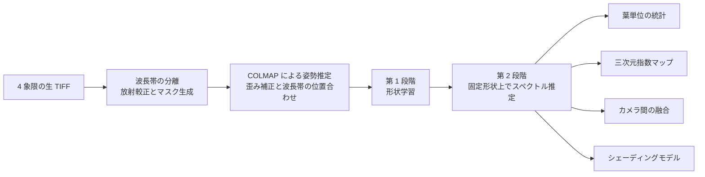

<h1 align="center">plant3d</h1>

<p align="center">
  3D Gaussian Splatting による植物のマルチスペクトル再構成と葉単位の植生指数計測
</p>

<p align="center">
  <a href="../pyproject.toml"></a>
  <a href="../pyproject.toml"></a>
  <a href="../third_party/gsplat"></a>
  <a href="../LICENSE"></a>
</p>

<p align="center">
  <a href="../README.md">English</a> · <a href="README.zh-CN.md">简体中文</a> · <strong>日本語</strong>
</p>

<p align="center">
  <a href="#overview">概要</a> ·
  <a href="#getting-started">クイックスタート</a> ·
  <a href="#method">手法</a> ·
  <a href="#results">実験結果</a> ·
  <a href="#citation">引用</a>
</p>

<p align="center">
  
  <br>
  <sub>6 つの方位角から描画した houseplant の三次元モデル。上段：カラー赤外合成。中段：レッドエッジ・クロロフィル指数（CIre）。下段：近赤外反射率。</sub>
</p>

<a id="overview"></a>

## 概要

**plant3d** は、多視点画像から植物を三次元再構成し、マルチスペクトルの計測値を個々の葉に対応付ける研究用実装です。[gsplat](https://github.com/nerfstudio-project/gsplat) により三次元ガウス表現を学習した後、形状を固定して各波長帯の反射率を推定します。

本プロジェクトは著者の大学在学中の研究に端を発し、公開に向けて構成を整理したものです。想定する撮影構成は、RGB カメラと、赤外線カットフィルターを取り外して 850 nm 狭帯域フィルターを装着した USB 産業用カメラの組み合わせです。ここで報告する実データの実験は、すべて公開の [Multispectral Greenhouse データセット](https://doi.org/10.5281/zenodo.18838172) を使用しており、その近赤外波長帯は 820 nm です。

- **マルチスペクトル再構成**：形状を学習した後、固定したガウス分布上でスペクトルを推定します。
- **葉単位の分析**：SAM による分割と視点間の対応付けを組み合わせ、実測の植生指数とその不確かさを集計します。
- **カメラ間の融合**：近赤外の観測を RGB カメラの視点へ転送し、二次元位置合わせと比較します。
- **可視化と評価**：三次元指数マップ、`.ply`・`.splat` 出力、ホールドアウト視点での評価、単純なベースラインとの比較を提供します。

> **適用範囲。** 実験で確認された主な利点は、異なる視点で観測された同じ葉の計測値を対応付けられることです。植物個体全体の NDVI では、三次元モデルが単純なベースラインを一貫して上回る結果は得られていません。反射率は推定した白色基準に対する相対値であり、指数の絶対値を解釈するには適切な放射較正が必要です。

<a id="getting-started"></a>

## クイックスタート

以下のコマンドはリポジトリのルートで実行してください。データセット、学習済みチェックポイント、実験用ノートブックは含まれていません。入力データはダウンロードスクリプトで別途取得します。

### 必要環境

| 項目 | リポジトリの設定 |
| :--- | :--- |
| Python | 3.12 |
| 環境管理 | [uv](https://docs.astral.sh/uv/) |
| PyTorch | 2.14.1、公式 CUDA 13.0 wheel インデックスを使用 |
| GPU | CUDA 対応 NVIDIA GPU |
| ビルド環境 | 設定済みの PyTorch ビルドと互換性のある CUDA toolkit（`nvcc` を含む）、および C++20 対応コンパイラ |
| gsplat | リポジトリ同梱の 1.5.3。付属の C++20 ビルドパッチを適用済み |
| ダウンロードスクリプト | Bash、`curl`、`python3` |

[pyproject.toml](../pyproject.toml) のビルド設定は `TORCH_CUDA_ARCH_LIST = "12.0"`、`CUDA_HOME = "/opt/cuda"` です。GPU や CUDA のインストール先が異なる場合は、**インストール前に**変更してください。ローカルの CUDA toolkit は、設定済みの PyTorch CUDA ビルドとメジャーバージョンを合わせる必要があります。

### 1. インストール

```bash
uv sync
uv run pytest
```

初回インストール時に gsplat の CUDA 拡張をコンパイルします。通常の `uv sync` は、テスト、描画、SAM による分割で使用する開発用依存パッケージもインストールします。CUDA または ficus データセットがない場合、それらを必要とするテストはスキップされます。

<details>
<summary>gsplat のビルド設定</summary>

[third_party/gsplat](../third_party/gsplat) のソースには、[gsplat-1.5.3-cxx20.patch](../third_party/gsplat-1.5.3-cxx20.patch) に記録された変更が適用済みです。設定済みの PyTorch ヘッダーに対応するため、CUDA コンパイラの言語標準を C++17 から C++20 に変更しています。

`[tool.uv.extra-build-variables]` の GPU アーキテクチャまたは CUDA パスを変更した場合は、拡張を再ビルドしてください。

```bash
uv sync --reinstall-package gsplat
```

</details>

### 2. ficus で形状学習を確認

NeRF-synthetic の ficus シーン（約 134 MB）を取得し、30,000 ステップ学習します。

```bash
./scripts/download_ficus.sh
uv run python -m plant3d.train_rgb \
  --data data/nerf_synthetic/ficus \
  --max-steps 30000 \
  --test-every 1 \
  --out outputs/ficus_rgb_30k
```

### 3. 植物のマルチスペクトル再構成

温室データ用スクリプトは HTTP Range リクエストを使い、指定した植物のみを取得します。`houseplant` は約 310 MB です。以下のコマンドは同じシェルセッションで実行してください。

```bash
P=houseplant
D="data/greenhouse/${P}_prep/undistorted"

# 生のスペクトル画像を取得し、前処理します。
./scripts/download_greenhouse.sh "$P"
uv run python -m plant3d.prep_greenhouse \
  --src "data/greenhouse/$P" \
  --out "data/greenhouse/${P}_prep"

# 第 1 段階：形状を学習します。
uv run python -m plant3d.train_rgb \
  --format colmap --data "$D" \
  --max-steps 30000 --test-every 4 --test-group 4 \
  --out "outputs/${P}_rgb"

# 第 2 段階：形状を固定し、スペクトルを推定します。
uv run python -m plant3d.train_channels \
  --geometry "outputs/${P}_rgb/ckpt_30000.pt" --data "$D" \
  --test-every 4 --test-group 4 --batch-views 4 \
  --out "outputs/${P}_spectral"

# 視点間で葉を対応付け、計測値を集計します。
uv run python -m plant3d.leaves \
  --spectral "outputs/${P}_spectral/spectral.pt" --data "$D" \
  --test-every 4 --test-group 4 \
  --out "outputs/${P}_leaves"
```

`--test-every 4 --test-group 4` は、4 フレームを 1 グループとし、4 グループごとに 1 グループを評価用に保持します。`houseplant` では、1 グループが同一方位で撮影した一連の画像に対応します。形状学習、スペクトル推定、葉単位の分析で同じ分割を使用してください。他のシーンでは、各方位のフレーム数に合わせて `--test-group` と葉の分析モジュールの `--frames-per-stop` を設定します（`cotton` は 5 フレーム）。葉の分割を初めて実行すると、Transformers が `facebook/sam-vit-base` をダウンロードします。

### 4. 出力の確認

| 出力 | 内容 |
| :--- | :--- |
| `outputs/${P}_rgb/ckpt_30000.pt` | スペクトル推定に使用する形状チェックポイント |
| `outputs/${P}_rgb/point_cloud.ply` | 再構成したガウスシーン |
| `outputs/${P}_spectral/spectral.pt` | 形状と学習したスペクトルチャネル |
| `outputs/${P}_spectral/point_cloud_ndvi.ply` | NDVI で着色したガウスシーン |
| `outputs/${P}_spectral/results.json` | 評価指標、ベースライン、信頼区間 |
| `outputs/${P}_leaves/gaussian_leaves.pt` | 各ガウス分布の葉ラベルと重み |
| `outputs/${P}_leaves/per_leaf_summary.csv` | 複数視点で実測した NDVI の平均、標準偏差、標準誤差 |

出力した `.ply` ファイルは [SuperSplat](https://superspl.at/editor) で表示できます。コマンドは `tyro` で引数を解析します。`--help` を付けると各オプションを確認できます。

```bash
uv run python -m plant3d.train_channels --help
```

<a id="method"></a>

## 手法



1. **前処理**：生 TIFF から緑、赤、レッドエッジ、近赤外の 4 波長帯を抽出します。推定した暗レベルを差し引き、白色基準で正規化します。COLMAP でカメラ姿勢を再推定し、レンズ歪みを補正して波長帯間の位置を合わせます。
2. **形状学習**：L1 + SSIM 損失で標準的な 3DGS を学習します。各ステップで画像をランダムな単色背景に合成し、背景のガウス分布を抑制します。
3. **スペクトル推定**：ガウス分布の位置、形状、不透明度を固定し、各波長帯の反射率を学習します。視点依存の球面調和関数項、フレームごとのゲイン、シェーディングモデル、1 ステップでの複数視点描画を任意に使用できます。
4. **葉の対応付けと分析**：学習視点で SAM による葉の分割を行い、マスクをガウス分布に投影して視点間で統合します。得られた三次元の葉ラベルを、葉単位の統計、指数マップ、融合実験に使用します。

## データ

[Multispectral Greenhouse データセット](https://doi.org/10.5281/zenodo.18838172) は [LGDWT-GS](https://arxiv.org/abs/2601.17185) とともに公開され、CC BY 4.0 で提供されています。5 個体の鉢植えを回転台に置き、黒背景と固定 LED 照明の下で撮影しています。4 レンズのスナップショット型カメラにより 580、660、735、820 nm を記録し、各個体は約 64 フレームで構成されます。本プロジェクトでは `houseplant`、`cotton`、`tomato` の結果を報告します。

<p align="center">
  
  <br>
  <sub>左：象限ごとに波長帯を格納した生 TIFF。右：各波長帯を個別に階調変換した対応する PNG。定量分析には生 TIFF を使用します。</sub>
</p>

前処理では、データセットで確認した以下の事項に対応しています。

| 確認事項 | 対応 |
| :--- | :--- |
| 付属の再構成はモデルごとに 64 フレーム中 16 フレームのみを登録し、COLMAP の既定焦点距離を使用 | COLMAP を再実行し、houseplant の全 64 フレームを登録。推定焦点距離は約 345 px、放射方向歪みは約 −0.12。 |
| 付属 PNG は波長帯ごとに 8 bit へ階調変換済み | TIFF に保存された元の 10 bit 計測値を使用。 |
| 明るい葉脈が白色基準の推定に混入 | 最も明るい 2% の候補から赤／近赤外比の低い画素を除外し、鉢と回転台を白色基準に使用。 |
| レンズ間に 0.4–0.76 px の固定ずれが存在 | 位相相関でずれを推定し、カメラごとの中央値を採用。歪み補正と位置合わせを 1 回の再サンプリングに統合。 |
| houseplant は各方位で 4 つの高さを撮影 | 方位グループ全体を評価用に保持し、同一方位の隣接高さが学習側に残らないように分割。 |
| グレー基準板が存在しない | 反射率を白い鉢に対する相対値として扱い、NDVI の絶対値は参考値として解釈。 |

<a id="results"></a>

## 実験結果

以下の図表と数値は、プロジェクトで報告された実験記録に基づきます。クイックスタートのコマンドは主要な処理手順を示しています。表全体を再現するには、対応する乱数シードと実験設定も必要です。

### 主な知見

- **局所的なスペクトル転送**：方位単位で保持した評価視点において、32 px ブロックの NDVI 誤差は **0.036**、定数ベースラインは **0.041** です。
- **個体全体での限界**：既定モデルの誤差は **0.023**、定数ベースラインは **0.018** です。1 次の視点依存項とフレームごとのゲインを併用した設定では **0.0174** となりました。
- **葉の対応付け**：同じ葉の視点間 NDVI 標準偏差は約 **0.04**、葉間では約 **0.03** です。複数視点の平均により標準誤差は約 **0.007** まで低下します。
- **カメラ間の融合**：本実験では、視点間の角度差が約 **2°** を超えると、三次元融合が二次元の平面位置合わせを上回ります。
- **放射較正への感度**：暗レベルと白色基準の選択は、それぞれ NDVI に約 **0.06** と **0.1** の差を生じさせ、ここで報告する再構成による改善幅を上回ります。

### ホールドアウト視点の NDVI 精度

houseplant では、方位グループ全体を単位として 16 視点を評価用に保持し、形状学習に 3 つの乱数シードを使用しています。誤差は描画値と実測 NDVI の平均絶対差です。角括弧は 95% ブートストラップ信頼区間、± はシード間の変動を示します。ダッシュは値が報告されていない項目です。

| 集計単位 | 三次元モデル | 定数ベースライン | 最近傍の学習視点 | 読み出しノイズ下限 |
| :--- | ---: | ---: | ---: | ---: |
| 画素 | 0.126 [0.116, 0.136] | — | — | 0.011 |
| 8 px ブロック | 0.067 [0.060, 0.075] | 0.066 | — | — |
| 32 px ブロック | 0.036 ± 0.001 | 0.041 | — | — |
| 個体全体 | 0.023 ± 0.000 | 0.018 | 0.023 | — |

<p align="center">
  
  <br>
  <sub>各植物のホールドアウト視点を 1 つずつ表示。左：カラー赤外合成。中央：実測 NDVI。右：三次元モデルから描画した NDVI。</sub>
</p>

処理手順とパラメータを変更せず、シード 0 を使用した結果は以下のとおりです。

| 指標 | houseplant | cotton | tomato |
| :--- | ---: | ---: | ---: |
| 登録フレーム数 | 64 | 50 | 42 |
| ホールドアウト視点数 | 16 | 15 | 9 |
| 形状 PSNR / シルエット IoU | 20.35 / 0.71 | 15.98 / 0.45 | 22.05 / 0.83 |
| 画素誤差 / ノイズ下限 | 0.126 / 0.011 | 0.125 / 0.018 | 0.109 / 0.010 |
| 32 px ブロック：モデル / 定数 | 0.036 / 0.041 | 0.054 / 0.066 | 0.038 / 0.030 |
| 個体全体：モデル / 定数 / 最近傍視点 | 0.023 / 0.018 / 0.023 | 0.039 / 0.018 / 0.010 | 0.017 / 0.016 / 0.009 |

個体全体では、3 個体のいずれでもモデルは単純なベースラインを上回りません。houseplant には約 −0.018 の系統的な NDVI バイアスがあり、葉内部の近赤外を約 6% 過小評価する傾向と関連しています。原因は未解明です。

### 葉単位の統計

<p align="center">
  
  <br>
  <sub>SAM マスクをガウス分布に投影して視点間で統合すると、三次元上で 19 枚の葉が得られます。そのうち 11 枚は統計分析に十分な視点数で観測されています。</sub>
</p>

単一のホールドアウト視点における葉単位の NDVI 誤差は **0.042** です。一方、同じ葉の学習視点での実測平均を用いた場合は **0.037** です。したがって、実験結果が支持する葉単位の出力は、実測値を複数視点で平均した値とその標準誤差であり、`per_leaf_summary.csv` に保存します。この集計は各葉が見える全評価視点を使用します。ホールドアウト視点での予測比較は別の評価として扱います。

### カメラ間の融合

`cam1` の緑・赤波長帯のみを使用して RGB カメラを、`cam2` の 820 nm 近赤外のみを使用して独立した近赤外カメラを模擬します。`cam1` の近赤外波長帯は正解値としてのみ使用します。カメラごとの色変換行列により、両カメラが同じ形状モデルを共有します。

この実験では全 64 フレームで学習し、32 個の `cam1` 視点でスペクトル転送を評価します。乱数シードは 3 つです。評価対象はカメラ間の転送であり、前述のホールドアウト視点の実験とは別に実施しています。

| 手法 | 画素 | 32 px ブロック | 個体全体 |
| :--- | ---: | ---: | ---: |
| 二次元：平面ホモグラフィ | 0.199 | 0.108 | 0.033 |
| 二次元：フレームごとの最適平面深度、正解値を用いた理想的な参照 | 0.175 | 0.098 | 0.041 |
| 三次元：近赤外を描画、赤を実測 | 0.123 | 0.068 | 0.032 |
| 三次元：近赤外と赤を描画 | 0.122 | 0.062 | 0.024 |

<p align="center">
  
  <br>
  <sub>視点間の角度差に伴う NDVI 誤差の変化。左：画素。中央：32 px ブロック。右：個体全体。</sub>
</p>

<p align="center">
  
  <br>
  <sub>視点間の角度差が 0.2°、8.3°、19.6° の場合の正解値と融合結果。</sub>
</p>

視点間の角度差が増えると、二次元手法の画素誤差は 0.09 から 0.26 に増加しますが、三次元手法の誤差はほぼ一定です。本実験では両曲線が約 2° で交差します。

### シェーディングモデル

`plant3d.train_channels` に `--shading` を指定すると、以下のモデルを有効にできます。

```text
観測値 = 反射率 × (環境光 + max(0, n·l) + 透過係数 × max(0, −n·l))
```

法線には扁平なガウス分布の最短軸を使用します。光源方向は各カメラの回転台座標系で一定とし、環境光と透過の項は波長帯ごとに学習します。

<p align="center">
  
  <br>
  <sub>シミュレーションにおける近赤外アルベドの復元。左：カメラ付近の光源。右：カメラと 70° 離れた光源。</sub>
</p>

- **シミュレーション**：真の反射率との相関係数は 0.88–0.92 から 0.999 に向上します。法線を平滑化した場合、環境光の推定値は真値 0.40 に対して 0.41、透過係数は真値 0.30 に対して 0.30–0.31 です。
- **実データ**：5 つのシードでホールドアウト誤差は変化しません。学習した近赤外の環境光は直接光の 2.7 倍となり、透過係数はゼロに近づきます。法線の平滑化による改善もありません。
- **残存する葉の向きの影響**：葉の近赤外と平均入射余弦の相関係数は、0.74 から 0.69 に低下するのみです。樹冠内の遮蔽、多重反射、鏡面反射、面光源などがモデルとの不一致に寄与している可能性があります。

新たに撮影したデータでこのモデルを検証する場合は、光源をカメラから離し、方向が既知の光源を 2～3 個使用してください。また、迷光を抑え、異なる向きのグレー基準板を配置してください。

### ficus による形状検証

全 200 テスト視点を評価しています。

| 学習時の背景 | ステップ数 | PSNR | SSIM | 背景の霧状アーティファクト率 | ガウス分布数 | 学習時間 |
| :--- | ---: | ---: | ---: | ---: | ---: | ---: |
| 白 | 30,000 | 28.44 | 0.971 | ≈90% | 308,000 | 10.5 min |
| ランダム | 7,000 | 31.47 | 0.980 | 0.08% | 132,000 | 2.2 min |
| ランダム | 30,000 | 33.63 | 0.986 | 0.04% | 178,000 | 8.7 min |

<p align="center">
  
  <br>
  <sub>上段：白背景で学習すると、黒背景での描画時に背景のガウス分布が現れます。下段：ランダム背景の学習により、この現象が抑制されます。</sub>
</p>

固定背景では、背景と同色のガウス分布が学習損失に反映されずに蓄積し、新しい視点から植物を遮る場合があります。ランダム背景への合成は既定で有効です。

## リポジトリ構成

Python モジュールは [`src/plant3d/`](../src/plant3d) にあります。

| モジュール・ディレクトリ | 用途 |
| :--- | :--- |
| `data.py` | NeRF-synthetic・COLMAP の読み込み、OpenCV のカメラ座標規約、視点のグループ分割 |
| `gaussians.py`、`losses.py` | ガウス分布の初期化、描画、最適化、チェックポイント、出力、画像損失 |
| `train_rgb.py` | 形状学習とカメラごとの色変換行列 |
| `prep_greenhouse.py` | 波長帯の抽出、放射較正、マスク、COLMAP、歪み補正、波長帯の位置合わせ |
| `train_channels.py`、`spectral.py` | スペクトル推定、NDVI/NDRE、評価、ベースライン、信頼区間 |
| `leaves.py` | SAM による分割、三次元での葉の対応付け、葉単位の統計 |
| `plant_maps.py`、`export_splat.py` | 三次元クロロフィル・構造指数マップ、`.ply`・`.splat` 出力、着色レイヤー |
| `fusion.py` | カメラ間の融合と平面ホモグラフィとの比較 |
| `shading.py`、`shading_sim.py` | シェーディングモデルとシミュレーションによる検証 |
| [`scripts/`](../scripts) | データの取得、リモート ZIP の選択的な展開、再試行・再開への対応 |
| [`tests/`](../tests) | データ座標規約、描画、出力、位置合わせの単体テスト |
| [`doc/`](.) | 中国語・日本語の README |
| [`docs/images/`](../docs/images) | 各言語版で共用する図 |
| [`third_party/`](../third_party) | 同梱の gsplat ソースとビルドパッチ |

## 謝辞

- **マルチスペクトルデータ**：[Multispectral Greenhouse](https://doi.org/10.5281/zenodo.18838172)。[LGDWT-GS](https://arxiv.org/abs/2601.17185) とともに公開、CC BY 4.0。
- **形状検証データ**：[NeRF-synthetic](https://www.matthewtancik.com/nerf) の ficus シーン。
- **ガウスラスタライズ**：[gsplat](https://github.com/nerfstudio-project/gsplat)、Apache 2.0。
- **葉の分割**：[Segment Anything](https://github.com/facebookresearch/segment-anything)。`facebook/sam-vit-base` を使用。

<a id="citation"></a>

## 引用

本コードまたは報告された結果を論文、報告書、その他の著作物で使用する場合は、著者を明記してください。機械可読の引用情報は [CITATION.cff](../CITATION.cff) にあります。

```bibtex
@software{hiro_plant3d_2026,
  author  = {Hiro},
  title   = {plant3d: Multispectral 3D Gaussian Splatting of Plants for Per-Leaf Vegetation Indices},
  year    = {2026},
  version = {0.1.0}
}
```

## ライセンス

本プロジェクトのコードは [PolyForm Noncommercial License 1.0.0](../LICENSE) で提供されます。その条項に従う非商用の使用・改変が認められます。商用利用には著者から別途ライセンスを取得する必要があります。再配布時にはライセンス条項またはその URL を添付し、`LICENSE` に記載された `Required Notice:` の表記を保持してください。

同梱する依存コードには元のライセンスが適用されます。gsplat は [Apache 2.0](../third_party/gsplat/LICENSE)、GLM は [MIT](../third_party/gsplat/gsplat/cuda/csrc/third_party/glm/copying.txt) です。Multispectral Greenhouse データセットは CC BY 4.0 で提供され、本リポジトリには含まれていません。`docs/images/` の図には、このデータセットおよび NeRF-synthetic の ficus シーンから生成した結果が含まれます。
