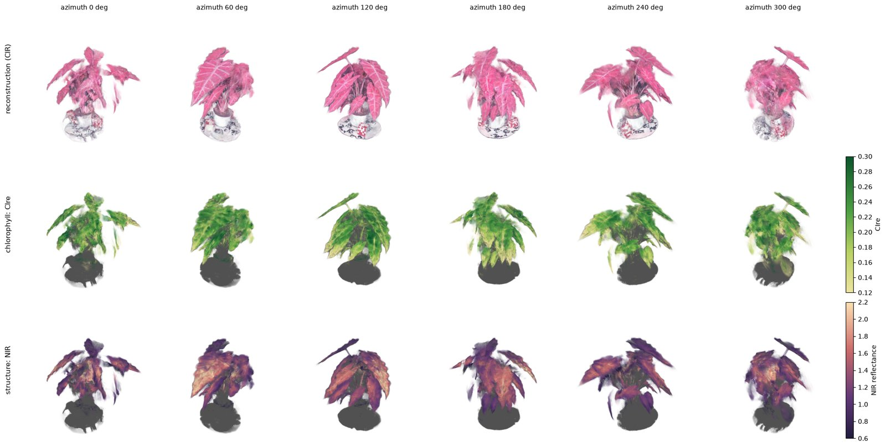
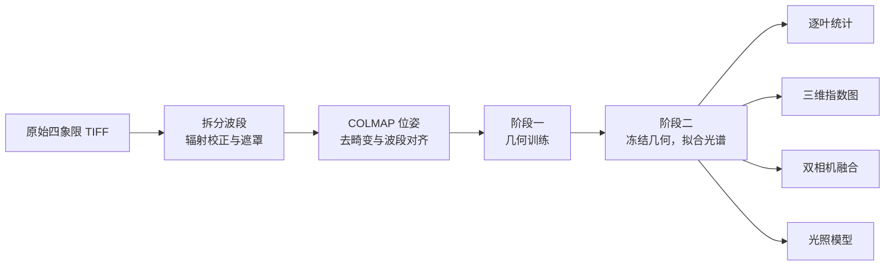
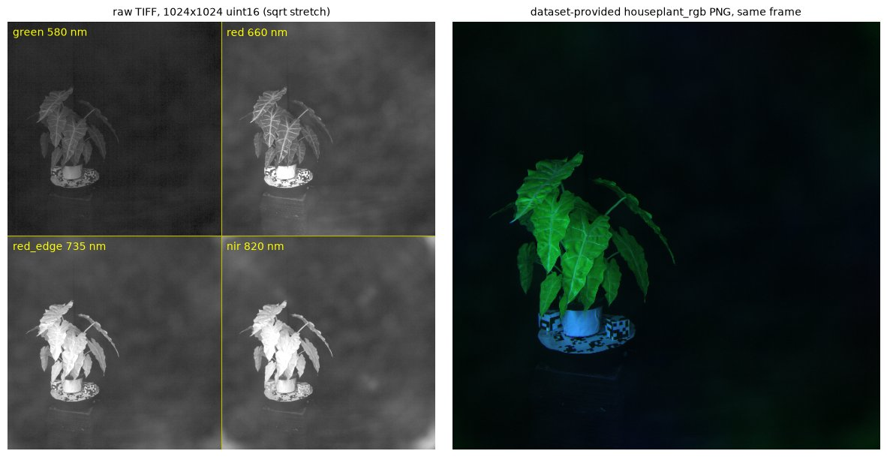
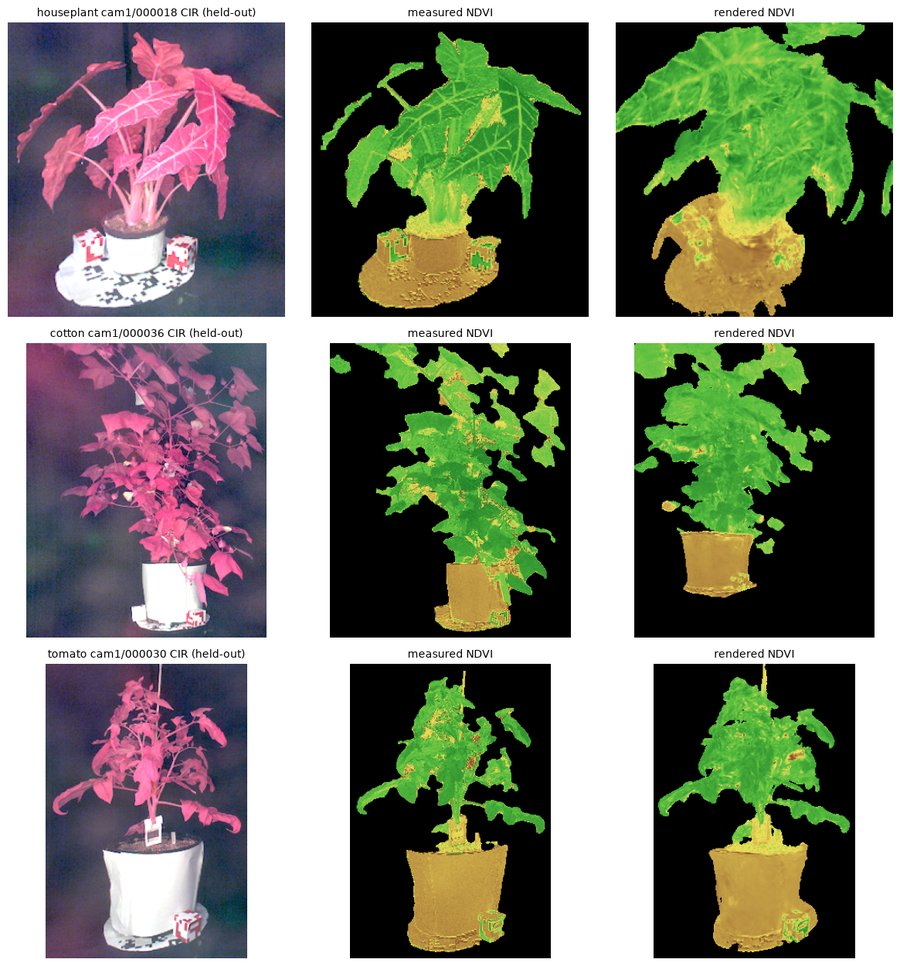
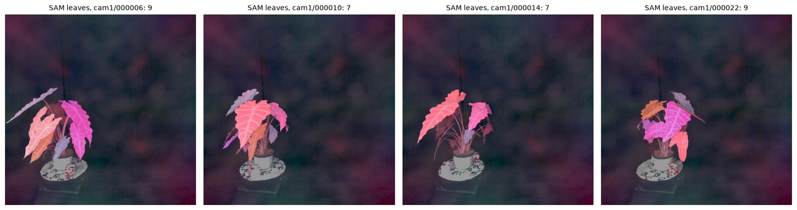
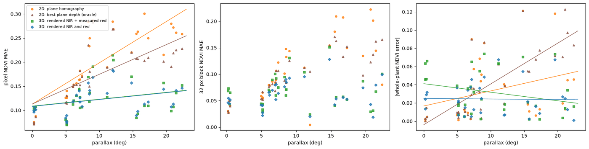
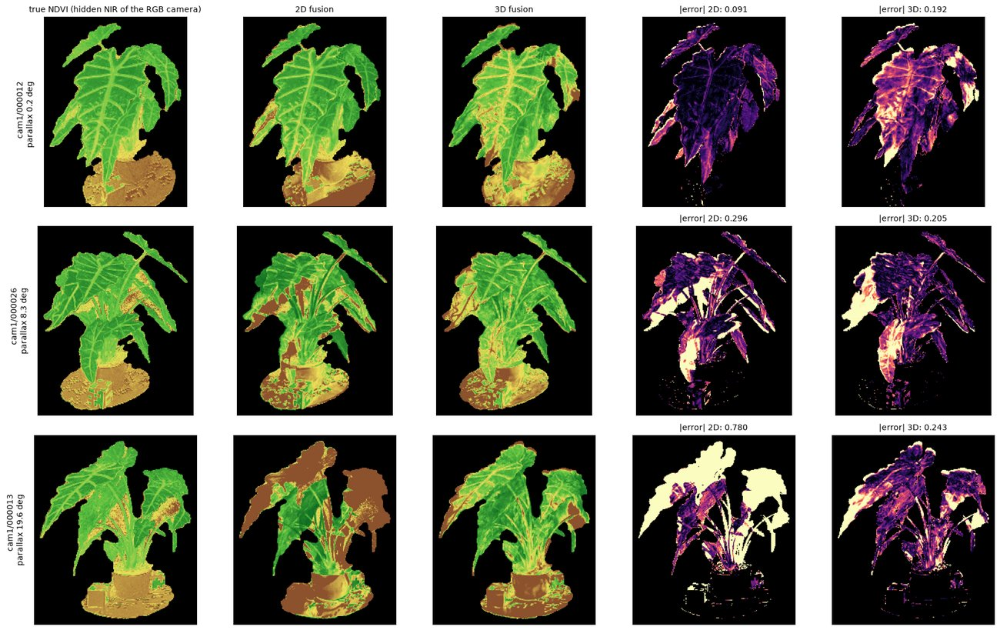
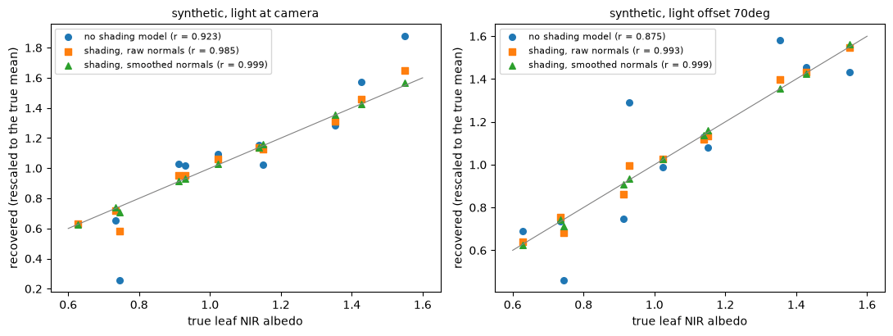
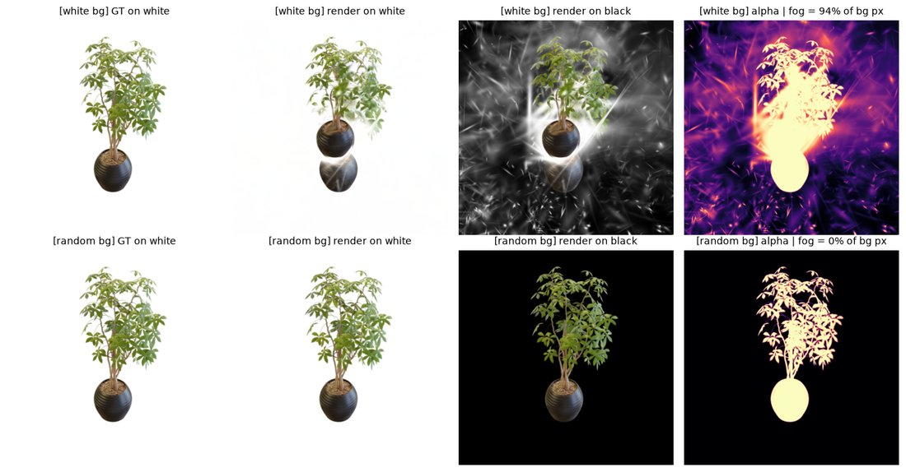

<h1 align="center">plant3d</h1>

<p align="center">
  基于三维高斯泼溅的植株多光谱重建与逐叶植被指数测量
</p>

<p align="center">
  <a href="../pyproject.toml"></a>
  <a href="../pyproject.toml"></a>
  <a href="../third_party/gsplat"></a>
  <a href="../LICENSE"></a>
</p>

<p align="center">
  <a href="../README.md">English</a> · <strong>简体中文</strong> · <a href="README.ja.md">日本語</a>
</p>

<p align="center">
  <a href="#overview">项目概述</a> ·
  <a href="#getting-started">快速开始</a> ·
  <a href="#method">方法</a> ·
  <a href="#results">实验结果</a> ·
  <a href="#citation">引用</a>
</p>

<p align="center">
  
  <br>
  <sub>houseplant 三维模型在六个方位角下的渲染。上：彩红外合成；中：红边叶绿素指数（CIre）；下：近红外反射率。</sub>
</p>

<a id="overview"></a>

## 项目概述

**plant3d** 是一个面向研究的植株多光谱重建项目，通过多视角图像建立三维模型，并将光谱测量关联到单片叶子。项目使用 [gsplat](https://github.com/nerfstudio-project/gsplat) 学习三维高斯表示，再在冻结的几何上估计各波段反射率。

本项目源自作者大学期间的一项课题，现经重新整理后公开发布。目标采集方案由一台 RGB 相机和一台 USB 工业相机组成；后者移除红外截止滤片，并安装 850 nm 窄带滤光片。本文报告的全部真实数据实验均使用公开的 [Multispectral Greenhouse 数据集](https://doi.org/10.5281/zenodo.18838172)，其近红外波段为 820 nm。

- **多光谱重建**：先训练几何，再在冻结的高斯上拟合光谱通道。
- **逐叶分析**：结合 SAM 分割与跨视角关联，统计实测植被指数及其不确定性。
- **双相机融合**：将近红外观测传递到 RGB 相机视角，并与二维配准比较。
- **可视化与评估**：提供三维指数图、`.ply` 与 `.splat` 导出、留出视角评估及简单基线。

> **适用范围。** 当前实验主要验证了跨视角关联同一叶片测量值的价值。三维模型在整株 NDVI 上并未持续优于简单基线。反射率以估计的白参考为基准；解释指数绝对值时，需要充分考虑辐射定标。

<a id="getting-started"></a>

## 快速开始

以下命令均在仓库根目录运行。仓库不包含数据集、训练 checkpoint 和实验笔记本；输入数据由下载脚本单独获取。

### 环境要求

| 组件 | 仓库配置 |
| :--- | :--- |
| Python | 3.12 |
| 环境管理 | [uv](https://docs.astral.sh/uv/) |
| PyTorch | 2.14.1，使用官方 CUDA 13.0 wheel 索引 |
| GPU | 支持 CUDA 的 NVIDIA GPU |
| 编译工具链 | 与当前 PyTorch 构建兼容的 CUDA toolkit，包含 `nvcc`，以及支持 C++20 的编译器 |
| gsplat | 仓库内置 1.5.3 源码，已应用随附的 C++20 编译补丁 |
| 下载脚本 | Bash、`curl` 和 `python3` |

[pyproject.toml](../pyproject.toml) 中的编译配置为 `TORCH_CUDA_ARCH_LIST = "12.0"`、`CUDA_HOME = "/opt/cuda"`。如显卡或 CUDA 安装路径不同，请在**安装前**修改这些配置。本地 CUDA toolkit 的主版本须与所配置的 PyTorch CUDA 构建一致。

### 1. 安装

```bash
uv sync
uv run pytest
```

首次安装会编译 gsplat 的 CUDA 扩展。默认执行 `uv sync` 也会安装测试、绘图和 SAM 分割所需的开发依赖。缺少 CUDA 或 ficus 数据集时，依赖相应条件的测试将被跳过。

<details>
<summary>gsplat 编译配置</summary>

[third_party/gsplat](../third_party/gsplat) 中的源码已包含 [gsplat-1.5.3-cxx20.patch](../third_party/gsplat-1.5.3-cxx20.patch) 所记录的修改：将 CUDA 编译器使用的语言标准从 C++17 改为 C++20，以适配当前配置的 PyTorch 头文件。

修改 `[tool.uv.extra-build-variables]` 中的 GPU 架构或 CUDA 路径后，重新编译扩展：

```bash
uv sync --reinstall-package gsplat
```

</details>

### 2. 在 ficus 上验证几何训练

下载 NeRF-synthetic 的 ficus 场景（约 134 MB），并训练 30,000 步：

```bash
./scripts/download_ficus.sh
uv run python -m plant3d.train_rgb \
  --data data/nerf_synthetic/ficus \
  --max-steps 30000 \
  --test-every 1 \
  --out outputs/ficus_rgb_30k
```

### 3. 重建多光谱植株

温室数据下载脚本通过 HTTP 范围请求仅获取指定植株，`houseplant` 约为 310 MB。请在同一终端会话中执行以下命令：

```bash
P=houseplant
D="data/greenhouse/${P}_prep/undistorted"

# 下载并预处理原始光谱图像。
./scripts/download_greenhouse.sh "$P"
uv run python -m plant3d.prep_greenhouse \
  --src "data/greenhouse/$P" \
  --out "data/greenhouse/${P}_prep"

# 阶段一：训练几何。
uv run python -m plant3d.train_rgb \
  --format colmap --data "$D" \
  --max-steps 30000 --test-every 4 --test-group 4 \
  --out "outputs/${P}_rgb"

# 阶段二：冻结几何，拟合光谱通道。
uv run python -m plant3d.train_channels \
  --geometry "outputs/${P}_rgb/ckpt_30000.pt" --data "$D" \
  --test-every 4 --test-group 4 --batch-views 4 \
  --out "outputs/${P}_spectral"

# 跨视角关联叶片并汇总测量值。
uv run python -m plant3d.leaves \
  --spectral "outputs/${P}_spectral/spectral.pt" --data "$D" \
  --test-every 4 --test-group 4 \
  --out "outputs/${P}_leaves"
```

`--test-every 4 --test-group 4` 将每四帧视为一组，每四组留出一组；对于 `houseplant`，一组对应一个完整方位的观测。几何训练、光谱拟合和逐叶分析应保持相同划分。使用其他场景时，应根据每个方位的帧数设置 `--test-group` 和叶片模块的 `--frames-per-stop`（`cotton` 为五帧）。首次运行叶片分割时，Transformers 会下载 `facebook/sam-vit-base` 模型。

### 4. 查看输出

| 输出 | 内容 |
| :--- | :--- |
| `outputs/${P}_rgb/ckpt_30000.pt` | 用于光谱拟合的几何 checkpoint |
| `outputs/${P}_rgb/point_cloud.ply` | 重建的高斯场景 |
| `outputs/${P}_spectral/spectral.pt` | 几何与学习到的光谱通道 |
| `outputs/${P}_spectral/point_cloud_ndvi.ply` | 按 NDVI 着色的高斯场景 |
| `outputs/${P}_spectral/results.json` | 评估指标、基线与置信区间 |
| `outputs/${P}_leaves/gaussian_leaves.pt` | 高斯对应的叶片标签及权重 |
| `outputs/${P}_leaves/per_leaf_summary.csv` | 多视角实测 NDVI 的均值、标准差和标准误 |

导出的 `.ply` 文件可在 [SuperSplat](https://superspl.at/editor) 中打开。命令使用 `tyro` 解析参数，追加 `--help` 可查看选项：

```bash
uv run python -m plant3d.train_channels --help
```

<a id="method"></a>

## 方法



1. **预处理**：从原始 TIFF 拆出绿、红、红边和近红外四个波段，扣除估计的暗电平，以白参考归一化；重新运行 COLMAP 求解位姿，去除镜头畸变，并对齐各光谱波段。
2. **几何训练**：以 L1 + SSIM 损失训练标准 3DGS。每步训练时将图像合成到随机纯色背景上，抑制背景高斯。
3. **光谱拟合**：冻结高斯的位置、形状和不透明度，学习各波段反射率。可选组件包括视角相关球谐项、逐帧增益、光照模型和每步多视角渲染。
4. **叶片关联与分析**：利用 SAM 在训练视角上分割叶片，将掩膜投影到高斯并跨视角合并。由此得到三维叶片标签，用于逐叶统计、指数图和融合实验。

## 数据

[Multispectral Greenhouse 数据集](https://doi.org/10.5281/zenodo.18838172) 随 [LGDWT-GS](https://arxiv.org/abs/2601.17185) 发布，采用 CC BY 4.0 许可。数据包含五株盆栽植物，每株置于转台上，在黑色背景和固定 LED 照明下拍摄。四镜头快照式相机记录 580、660、735 和 820 nm 四个波段，每株约 64 帧。本项目报告 `houseplant`、`cotton` 和 `tomato` 的实验结果。

<p align="center">
  
  <br>
  <sub>左：原始 TIFF，每个象限对应一个光谱波段；右：同一帧的配套 PNG，各波段已独立拉伸。定量分析使用原始 TIFF 数据。</sub>
</p>

预处理流程针对数据集中的以下情况进行处理：

| 观察到的问题 | 处理方式 |
| :--- | :--- |
| 自带重建每个模型仅注册 16/64 帧，使用 COLMAP 默认焦距 | 重新运行 COLMAP，houseplant 的 64 帧全部注册；估计焦距约 345 px，径向畸变约 −0.12。 |
| 自带 PNG 已逐波段拉伸为 8 bit | 读取 TIFF 中保存的原始 10 bit 测量值。 |
| 明亮叶脉污染白参考估计 | 在最亮的 2% 候选像素中剔除红光与近红外之比偏低者，以花盆和转盘作为白参考。 |
| 镜头之间存在 0.4–0.76 px 的固定偏移 | 通过相位相关估计偏移，逐相机取中位数，将对齐与去畸变合并为一次重采样。 |
| houseplant 每个方位拍摄四个高度 | 留出完整方位组，避免训练集保留同一方位的相邻高度观测。 |
| 未放置灰参考板 | 将反射率视为相对白色花盆的亮度比，NDVI 绝对值仅作参考。 |

<a id="results"></a>

## 实验结果

以下图表与数值保留自项目已有实验记录。快速开始命令覆盖主流程；完整复现各表还需要对应的随机种子和实验配置。

### 主要结论

- **局部光谱传递**：在整方位留出的视角上，32 px 块的 NDVI 误差为 **0.036**，常数基线为 **0.041**。
- **整株尺度的局限**：默认模型误差为 **0.023**，常数基线为 **0.018**；一阶视角项与逐帧增益组合达到 **0.0174**。
- **叶片关联**：同一叶片在不同视角下的 NDVI 标准差约为 **0.04**，叶片间约为 **0.03**；多视角平均后的标准误约为 **0.007**。
- **双相机融合**：在本实验中，两视角角度差超过约 **2°** 时，三维融合优于二维平面配准。
- **辐射定标敏感性**：暗电平与白参考的取法分别造成约 **0.06** 和 **0.1** 的 NDVI 差异，大于本文报告的重建改进幅度。

### 留出视角的 NDVI 精度

houseplant 评估按完整方位组留出 16 个视角，使用 3 个几何种子。误差为渲染与实测 NDVI 的平均绝对差。方括号表示 95% bootstrap 置信区间；± 表示不同种子间的变动。横线表示未报告该项数值。

| 尺度 | 三维模型 | 常数基线 | 最近训练视角 | 读出噪声下限 |
| :--- | ---: | ---: | ---: | ---: |
| 单像素 | 0.126 [0.116, 0.136] | — | — | 0.011 |
| 8 px 块 | 0.067 [0.060, 0.075] | 0.066 | — | — |
| 32 px 块 | 0.036 ± 0.001 | 0.041 | — | — |
| 整株 | 0.023 ± 0.000 | 0.018 | 0.023 | — |

<p align="center">
  
  <br>
  <sub>每株植物各一个留出视角。左：彩红外合成；中：实测 NDVI；右：三维模型渲染的 NDVI。</sub>
</p>

保持流程与参数不变，种子为 0 时，三株植物的结果如下：

| 指标 | houseplant | cotton | tomato |
| :--- | ---: | ---: | ---: |
| 注册帧数 | 64 | 50 | 42 |
| 留出视角 | 16 | 15 | 9 |
| 几何 PSNR / 轮廓 IoU | 20.35 / 0.71 | 15.98 / 0.45 | 22.05 / 0.83 |
| 单像素误差 / 噪声下限 | 0.126 / 0.011 | 0.125 / 0.018 | 0.109 / 0.010 |
| 32 px 块：模型 / 常数 | 0.036 / 0.041 | 0.054 / 0.066 | 0.038 / 0.030 |
| 整株：模型 / 常数 / 最近视角 | 0.023 / 0.018 / 0.023 | 0.039 / 0.018 / 0.010 | 0.017 / 0.016 / 0.009 |

三株植物在整株尺度上均未优于简单基线。houseplant 存在约 −0.018 的 NDVI 系统偏差，与叶片内部近红外约 6% 的低估相关，原因尚未查明。

### 逐叶统计

<p align="center">
  
  <br>
  <sub>将 SAM 掩膜投影到高斯并跨视角合并后，得到 19 片三维叶片，其中 11 片在足够多的视角中可见，可用于统计分析。</sub>
</p>

单个留出视角的逐叶 NDVI 误差为 **0.042**，以该叶片在训练视角中的实测均值预测时为 **0.037**。因此，得到实验支持的逐叶输出是实测值的多视角均值及其标准误，保存于 `per_leaf_summary.csv`。该汇总使用每片叶子可见的全部已评估视角；留出视角的预测比较属于单独的评估。

### 双相机融合

实验仅使用 `cam1` 的绿、红波段模拟 RGB 相机，仅使用 `cam2` 的 820 nm 波段模拟独立近红外相机。`cam1` 的近红外波段仅用于真值评估。逐相机颜色矩阵使两台相机能够共享同一几何模型。

该实验使用全部 64 帧训练，并在 32 个 `cam1` 视角上评估光谱传递，使用 3 个种子。它衡量的是跨相机传递能力，与前述留出视角实验分别进行。

| 方法 | 单像素 | 32 px 块 | 整株 |
| :--- | ---: | ---: | ---: |
| 二维：平面单应 | 0.199 | 0.108 | 0.033 |
| 二维：逐帧最优平面深度，使用真值的理想参照 | 0.175 | 0.098 | 0.041 |
| 三维：渲染近红外，实测红光 | 0.123 | 0.068 | 0.032 |
| 三维：近红外与红光均渲染 | 0.122 | 0.062 | 0.024 |

<p align="center">
  
  <br>
  <sub>NDVI 误差随视角角度差的变化。左：单像素；中：32 px 块；右：整株。</sub>
</p>

<p align="center">
  
  <br>
  <sub>视角角度差为 0.2°、8.3° 和 19.6° 时的真值与融合结果。</sub>
</p>

随着视角角度差增大，二维方法的单像素误差由 0.09 增至 0.26，三维误差则基本稳定。在本实验中，两条曲线约在 2° 处交叉。

### 光照模型

在 `plant3d.train_channels` 中通过 `--shading` 启用可选光照模型：

```text
观测值 = 反射率 × (环境光 + max(0, n·l) + 透射系数 × max(0, −n·l))
```

法向量取扁平高斯的最短轴。光源方向在各相机的转台坐标系中为常量；环境光和透射项按波段学习。

<p align="center">
  
  <br>
  <sub>模拟数据中的近红外反照率恢复。左：光源位于相机旁；右：光源与相机相差 70°。</sub>
</p>

- **模拟数据**：恢复值与真实反射率的相关系数由 0.88–0.92 提高至 0.999。法向量平滑后，环境光恢复值为 0.41，真值为 0.40；透射系数恢复值为 0.30–0.31，真值为 0.30。
- **真实数据**：5 个种子的留出误差均无变化。学习到的近红外环境光为直射项的 2.7 倍，透射系数趋近于零；法向量平滑亦无改善。
- **剩余朝向效应**：叶片近红外与平均受光余弦的相关系数仅从 0.74 降至 0.69。冠层遮挡、多次反射、叶面镜面反射和面光源可能是模型不匹配的原因。

若使用自采数据检验该模型，应使光源与相机分离，采用两至三个已知方向的光源，减少杂散光，并放置不同朝向的灰参考板。

### ficus 几何验证

评估使用全部 200 个测试视角。

| 训练背景 | 步数 | PSNR | SSIM | 背景雾比例 | 高斯数 | 训练时间 |
| :--- | ---: | ---: | ---: | ---: | ---: | ---: |
| 白色 | 30,000 | 28.44 | 0.971 | ≈90% | 308,000 | 10.5 min |
| 随机 | 7,000 | 31.47 | 0.980 | 0.08% | 132,000 | 2.2 min |
| 随机 | 30,000 | 33.63 | 0.986 | 0.04% | 178,000 | 8.7 min |

<p align="center">
  
  <br>
  <sub>上：白背景训练产生的背景高斯在黑背景渲染时显现；下：随机背景训练抑制了这一现象。</sub>
</p>

固定背景允许与背景同色的高斯不断累积，而训练损失无法反映这些高斯的存在；它们可能在新视角遮挡植株。随机背景合成现已默认启用。

## 仓库结构

Python 模块位于 [`src/plant3d/`](../src/plant3d)。

| 模块或目录 | 用途 |
| :--- | :--- |
| `data.py` | NeRF-synthetic 与 COLMAP 数据读取、OpenCV 相机坐标约定、分组视角划分 |
| `gaussians.py`、`losses.py` | 高斯初始化、渲染、优化、checkpoint、导出与图像损失 |
| `train_rgb.py` | 几何训练与逐相机颜色矩阵 |
| `prep_greenhouse.py` | 波段拆分、辐射校正、遮罩、COLMAP、去畸变与波段对齐 |
| `train_channels.py`、`spectral.py` | 光谱拟合、NDVI/NDRE、评估、基线与置信区间 |
| `leaves.py` | SAM 分割、三维叶片关联与逐叶统计 |
| `plant_maps.py`、`export_splat.py` | 三维叶绿素与结构指数图、`.ply`/`.splat` 导出及着色层 |
| `fusion.py` | 双相机融合与平面单应对照 |
| `shading.py`、`shading_sim.py` | 光照模型与模拟验证 |
| [`scripts/`](../scripts) | 数据下载与远程 ZIP 选择性提取，支持重试与续传 |
| [`tests/`](../tests) | 数据坐标约定、渲染、导出与配准的单元测试 |
| [`doc/`](.) | 中文与日文 README |
| [`docs/images/`](../docs/images) | 各语言版本共用的图像 |
| [`third_party/`](../third_party) | 仓库内置的 gsplat 源码与编译补丁 |

## 致谢

- **多光谱数据**：[Multispectral Greenhouse](https://doi.org/10.5281/zenodo.18838172)，随 [LGDWT-GS](https://arxiv.org/abs/2601.17185) 发布，CC BY 4.0。
- **几何验证数据**：[NeRF-synthetic](https://www.matthewtancik.com/nerf) 中的 ficus 场景。
- **高斯光栅化**：[gsplat](https://github.com/nerfstudio-project/gsplat)，Apache 2.0。
- **叶片分割**：[Segment Anything](https://github.com/facebookresearch/segment-anything)，使用 `facebook/sam-vit-base`。

<a id="citation"></a>

## 引用

如在论文、报告或其他作品中使用本项目代码或报告的结果，请注明作者。[CITATION.cff](../CITATION.cff) 提供机器可读的引用信息。

```bibtex
@software{hiro_plant3d_2026,
  author  = {Hiro},
  title   = {plant3d: Multispectral 3D Gaussian Splatting of Plants for Per-Leaf Vegetation Indices},
  year    = {2026},
  version = {0.1.0}
}
```

## 许可

项目代码以 [PolyForm Noncommercial License 1.0.0](../LICENSE) 发布，允许在其条款范围内进行非商业使用与修改。商业用途须另行取得作者授权。分发时须附带许可条款或其网址，并保留 `LICENSE` 中的 `Required Notice:` 声明。

仓库内置的依赖保留各自原有许可：gsplat 采用 [Apache 2.0](../third_party/gsplat/LICENSE)，GLM 采用 [MIT](../third_party/gsplat/gsplat/cuda/csrc/third_party/glm/copying.txt)。Multispectral Greenhouse 数据集采用 CC BY 4.0，未包含在本仓库中。`docs/images/` 中的图像包含由该数据集和 NeRF-synthetic ficus 场景生成的结果。
